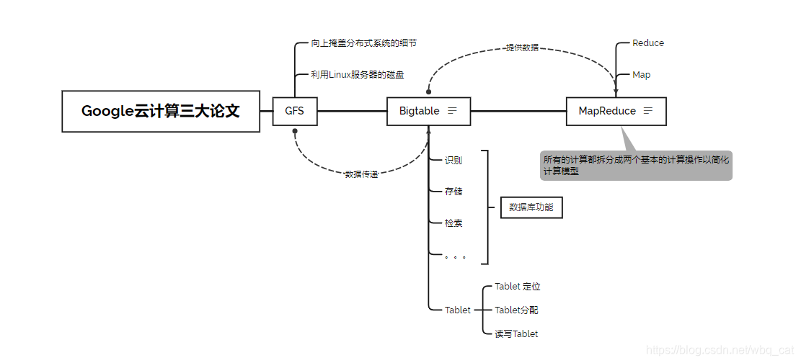
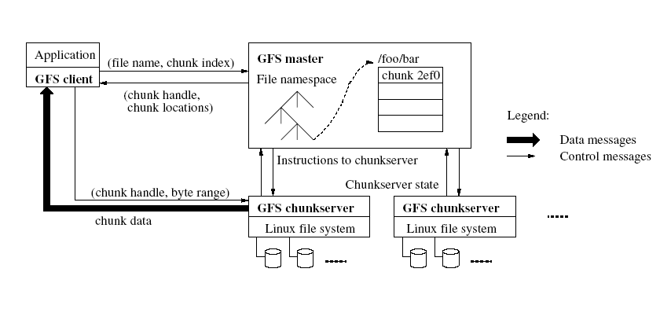
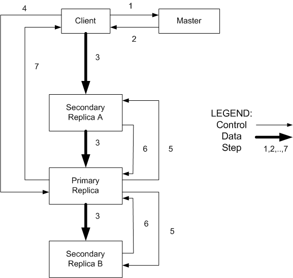

三篇论文分别解决大规模数据的存储、计算与结构化查询，叠起来才是一套完整的分布式数据栈。读完能说清三者的边界、各自的容错假设，以及今天的开源对应物。

## 三者的分工

GFS 存字节流，MapReduce 在这批字节上做批量计算，Bigtable 在 GFS 之上提供按行键索引的表。依赖关系是 Bigtable → GFS；MapReduce 的输入输出都落在 GFS 上，也可以直接读 Bigtable。

## GFS：默认机器会坏

设计前提来自论文第一节：用廉价商用机，部件故障视为常态而非异常；以大文件为主，通常 100MB 以上，也要能高效处理 GB 级文件；负载以大规模顺序读、小规模随机读、大规模追加写为主；吞吐比延迟重要[^1]。

架构只有三个角色：

| 角色        | 职责                                                            |
| :---------- | :-------------------------------------------------------------- |
| master      | 存命名空间、访问控制、文件到 chunk 的映射、chunk 位置；不存数据 |
| chunkserver | chunk 存本地磁盘，按 handle 与字节范围读写                      |
| client      | 向 master 取元数据，直接向 chunkserver 读写数据                 |

文件被切成固定大小的 chunk（默认 64MB），每个 chunk 由 master 在创建时分配全局唯一的 64 位 handle，默认存 3 份副本。

读流程是「问一次路，之后直达」：

1. client 按 chunk 大小算出要读的 index 与字节范围，把文件名和 index 发给 master；
2. master 返回 chunk handle 与副本位置；
3. client 选最近的 chunkserver，按 handle 与 offset 读数据。

写入不逐块经过 master，而是用 lease 把主副本授权给某个 chunkserver，数据沿副本链流水线推送，见论文的写流程[^2]。

快照用引用计数加写时复制实现，所以能瞬时完成且不打断进行中的写入；用途是给大数据集开分支，或在实验性操作前留回滚点。快照记录某一时刻的状态，备份是另一份完整的副本，两者不能互相替代[^3]。

## MapReduce：把计算搬到数据旁边

编程模型只有两个函数：`map(k1, v1)` 输出一组中间键值对，`reduce(k2, list(v2))` 把同一个键的所有值合并成结果[^4]。

执行时 master 分配 M 个 map 任务与 R 个 reduce 任务：map 读 GFS 上的分片，把中间结果按 key 的哈希分区写入本地磁盘；reduce 通过 RPC 拉取自己负责的分区，按 key 排序后归约，结果写回 GFS。中间结果落在本地磁盘而不是 GFS，省掉了三次副本的网络开销。

容错靠重跑：worker 挂了，它已完成的 map 任务要重跑，因为中间结果在本地；reduce 任务直接重跑，输出用原子 rename 提交，避免读到半成品。长尾用 backup task 兜底——某个任务明显慢于其余分片时同时起一份副本，先完成者胜出。

## Bigtable：稀疏、分布式的多维排序 Map

数据模型是三维索引：行键、列族（以及列族下的限定符）、时间戳。行键按字典序排列，单行读写原子；数据稀疏，空单元格不占空间。

存储上，表按行切分为 tablet，tablet 的 SSTable 与提交日志存在 GFS 上，元数据与锁交给 Chubby。内存里的 memtable 刷成不可变 SSTable，后台做合并压缩。

它启发了 HBase 与 Cassandra，后者借用了数据模型、SSTable 与预写日志[^5]。

## 结语

三者的定位可以一句话记住：GFS 解决这么大怎么存，MapReduce 解决这么多怎么算，Bigtable 解决这么杂怎么查。今天的开源对应物是 HDFS、Hadoop MapReduce（引擎多被 Spark 取代，编程模型仍在）与 HBase / Cassandra。

[^1]: [The Google File System](https://static.googleusercontent.com/media/research.google.com/en//archive/gfs-sosp2003.pdf)

[^2]: [Massive Information processing - Concurrency and Fault-Tolerance: The Google Approach](https://cis.temple.edu/~giorgio/cis307/readings/MapReduce/MapReduce.html)

[^3]: [快照与备份有什么区别？](https://www.zhihu.com/question/20374919/answer/499376887)

[^4]: [MapReduce: Simplified Data Processing on Large Clusters](https://research.google.com/archive/mapreduce-osdi04.pdf)

[^5]: [Bigtable: A Distributed Storage System for Structured Data](https://research.google.com/archive/bigtable-osdi06.pdf)
