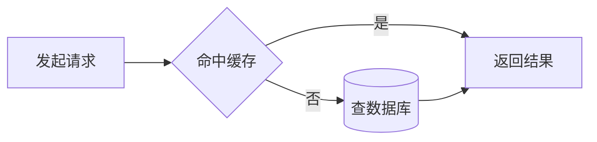
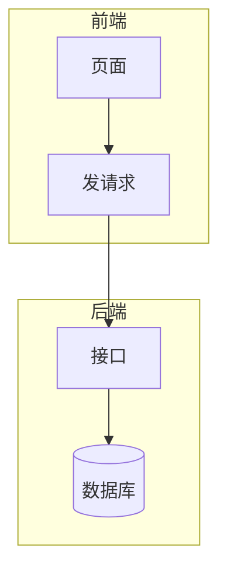
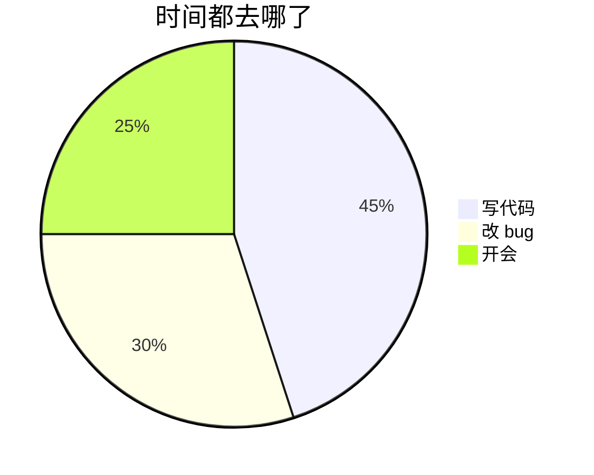

图写在代码块里有三个好处：能进版本控制、能 review diff、改图等于改文本。Mermaid 用接近 Markdown 的语法画流程图、饼图、时序图等，GitHub、Typora、Obsidian 与本站主题（Stack 的 `render-codeblock-mermaid` 局部模板）都会把 mermaid 代码块渲染成图。

## 流程图：方向、节点、连线

方向写在第一行：`TB` / `TD` 从上到下、`BT` 从下到上、`LR` 从左到右、`RL` 从右到左。`graph` 是 `flowchart` 的旧写法，官方文档明确说两者等价。

节点形状由包裹符号决定：

| 写法        | 形状           |
| :---------- | :------------- |
| `A[文本]`   | 矩形           |
| `A(文本)`   | 圆角矩形       |
| `A([文本])` | 体育场形       |
| `A[[文本]]` | 子程序         |
| `A[(文本)]` | 圆柱           |
| `A((文本))` | 圆形           |
| `A{文本}`   | 菱形           |
| `A{{文本}}` | 六边形         |
| `A[/文本/]` | 平行四边形     |
| `A[\文本\]` | 反向平行四边形 |
| `A[/文本\]` | 梯形           |
| `A[\文本/]` | 反向梯形       |

Mermaid 11.3 起还支持显式形状写法 `A@{ shape: cyl }`，形状总数扩到 30 多个（`cloud`、`doc`、`person`、`fork` 等）。

连线：

| 写法              | 效果                 |
| :---------------- | :------------------- |
| `A --> B`         | 实线箭头             |
| `A --- B`         | 实线无箭头           |
| `A -.-> B`        | 虚线箭头             |
| `A ==> B`         | 粗线箭头             |
| `A -- 文本 --> B` | 带文字的实线         |
| `A -->\|文本\| B` | 同上，另一种写法     |
| `A --> B & C`     | 一次连两个目标       |
| `A ---> B`        | 多一个 `-`，箭头更长 |

## 子图与注释

`%%` 开头是注释，渲染时不可见。`subgraph` 与 `end` 必须成对。

## 饼图

分区名写在引号里，`:` 后是数值，渲染成百分比。

## 三个会让图直接画错的坑

1. 节点文本里出现小写 `end`：解析器把它当成 `subgraph` 的结束关键字，整张图报错。写成 `End` 或 `END`。
2. 节点 id 以 `o` 或 `x` 开头且紧跟在 `---` 之后：`A---oB` 不是「连到 oB」，而是从 A 到 B 的圆头连线；`A---xB` 同理变成叉头连线。加一个空格或把首字母大写即可。
3. 节点文本含括号、方括号、花括号时必须加引号：`A["set(1, 2)"]`，否则括号会被当成形状语法解析失败。

## 结语

流程图记住三段就够用：方向、形状、连线；其余图（`sequenceDiagram`、`classDiagram`、`gantt`、`gitGraph`）各对应官网一页。当前主版本是 12，v12 把流程图默认布局从 Dagre 换成了 ELK、默认主题也改了，同一份代码在新版本里样式会变，语义不变。
