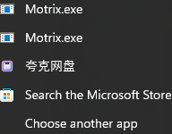

装完 Motrix 发现，右键 `.torrent` 文件时的「打开方式」列表长歪了：两个一模一样的 `Motrix.exe`（通用图标）、一个早就卸载掉的「夸克网盘」，而点「夸克网盘」打开的却是 Motrix。

这三个毛病看着像同一件事，其实是三份互不认账的注册表记录叠在一起。下面先把「打开方式」列表的拼装规则讲清楚，再逐条对照菜单里的条目找它的来路，最后是备份、清理和验证。

## 现象



前三条是这篇文章要解决的，后两条是系统自带。

关键线索有两条：两个 `Motrix.exe` 都没有图标，说明它们所属的注册表记录里根本没写图标；「夸克网盘」有图标、有名字，图标和名字却不属于同一个程序。

顺带一提，这台机器上早就没有夸克网盘了（卸载时没清干净），Motrix 则是刚装上不久的 1.8.19：

```powershell
winget install -e --id agalwood.Motrix
```

它的可执行文件在 `C:\Users\<username>\AppData\Local\Programs\Motrix\Motrix.exe`。

## 「打开方式」列表是怎么来的

一句话：列表由三类记录合并而成，任何一类留下垃圾，菜单里就会多一条。

| 来源 | 注册表位置 | 显示名和图标从哪来 |
| :--- | :--- | :--- |
| 程序级注册 | `HKCU\Software\Classes\Applications\<exe>` | `shell\open` 下的 `FriendlyAppName`、根键下的 `DefaultIcon` |
| ProgID 注册 | `HKCU\Software\Classes\<ProgID>` | 同上；两者缺其一就退回备用显示 |
| 扩展名关联 | `HKCU\Software\Classes\<ext>`、`...\Explorer\FileExts\<ext>\OpenWithProgids` | 引用上面两类 ProgID |

`FriendlyAppName` 缺了，显示名就只能用 exe 文件名；`DefaultIcon` 缺了，就只剩下通用图标。这就是那两个灰扑扑的 `Motrix.exe` 的成因——不是 Motrix 没带图标，是那两条记录里没写。

菜单还会跳过解析不到程序的条目。这台机器的 `OpenWithList` 里还残留着一个 `qbittorrent.exe`，但 qBittorrent 早就没装了，菜单里也就没有它。可见残留本身不一定显形，要显形得有对应的程序记录托着。

## 三条记录，三个来路

### 幽灵一：指向已删除目录的 `Applications\Motrix.exe`

```text
> reg query "HKCU\Software\Classes\Applications\Motrix.exe" /s

HKEY_CURRENT_USER\Software\Classes\Applications\Motrix.exe\shell\open\command
    (Default)    REG_SZ    "D:\Other program Files\Motrix-1.8.19-win\Motrix.exe" "%1"
```

整个 `Applications\Motrix.exe` 下只有一个 `shell\open\command`，没有 `FriendlyAppName`，也没有 `DefaultIcon`。它指向的 `D:\Other program Files\Motrix-1.8.19-win\` 是我更早一次手动安装留下的目录，文件夹早就被删了，注册表记录却一直留着。

### 幽灵二：自动生成的 `torrent_auto_file`

```text
> reg query "HKCU\Software\Classes\torrent_auto_file" /s

HKEY_CURRENT_USER\Software\Classes\torrent_auto_file\shell\open\command
    (Default)    REG_SZ    "D:\Other program Files\Motrix-1.8.19-win\Motrix.exe" "%1"
```

`*_auto_file` 是 Windows 在「始终使用此应用打开」时自动创建的 ProgID，命名规则是「扩展名 + `_auto_file`」，内容是做出选择那一刻的程序路径。这份记录也是在那次 D 盘安装期间生成的，所以同样指向死路径。

它里面没有任何 `FriendlyAppName` 可读，显示名只能退回到命令行里那个 exe 名，于是它和幽灵一长得一模一样——菜单里两条重复的 `Motrix.exe`，就是这么来的。

### 幽灵三：`Torrent` 里那句没被覆盖的 `FriendlyAppName`

```text
> reg query "HKCU\Software\Classes\Torrent" /s

HKEY_CURRENT_USER\Software\Classes\Torrent
    (Default)    REG_SZ
    URL Protocol    REG_SZ

HKEY_CURRENT_USER\Software\Classes\Torrent\DefaultIcon
    (Default)    REG_SZ    C:\Users\<username>\AppData\Local\Programs\Motrix\resources\torrent.ico

HKEY_CURRENT_USER\Software\Classes\Torrent\Shell\Open
    (Default)    REG_SZ    Open with Motrix
    FriendlyAppName    REG_SZ    夸克网盘

HKEY_CURRENT_USER\Software\Classes\Torrent\Shell\Open\command
    (Default)    REG_SZ    "C:\Users\<username>\AppData\Local\Programs\Motrix\Motrix.exe" "%1"
```

图标是 Motrix 的、命令是 Motrix 的、连 `Shell\Open` 的默认值都写着 `Open with Motrix`，唯独 `FriendlyAppName` 还是「夸克网盘」。Explorer 读显示名时优先取这个值，于是这条记录被渲染成「夸克网盘」，点下去启动的却是命令里那个 Motrix。

为什么名字会留在夸克那儿？我的推断是这样：`Torrent` 是个很通用的 ProgID 名字，夸克网盘早先占用了它并写下 `FriendlyAppName`；后来 Motrix 的安装程序接管 `.torrent` 关联时覆盖了图标和命令，偏偏没覆盖这个名字。前后顺序没法从注册表里考证，但「图标命令是新的、名字是旧的」这个组合本身就说明两份安装程序改的是同一条记录。

值得一提的是，`.torrent` 在 `Classes` 下的默认值原本指向这个 `Torrent`，`OpenWithProgids` 里同时列着 `Torrent` 和 `torrent_auto_file`——三条记录全在菜单里露了脸。

### 顺带：双击其实也是坏的

```text
> reg query "HKCU\Software\Microsoft\Windows\CurrentVersion\Explorer\FileExts\.torrent\UserChoice" /v ProgId

    ProgId    REG_SZ    Applications\Motrix.exe
```

默认打开程序登记的是 `Applications\Motrix.exe`，而它的命令指向 D 盘死路径。也就是说，光装上 Motrix 并不会让双击恢复，默认程序那一层仍然指着一条走不通的路。同一个目录下还有一条 `UserChoiceLatest`，指向 `torrent_auto_file`，那是上一次「始终使用」的落款。

## 为什么重装治不好

`winget install` 只负责把文件铺到 `%LOCALAPPDATA%\Programs\Motrix`，并写入它自己的协议注册；它不会去打扫别人的旧关联，也无权判断 D 盘那条旧记录还要不要。所以重装之后，新程序有了，旧记录一条没少，菜单自然还是乱的。

再加上 `.torrent` 关联在历史上被两个程序先后改过，`FriendlyAppName`、`DefaultIcon`、`shell\open\command` 分别停在不同时代的值上，靠「再装一遍」或「重新选一次打开方式」是修不好的——后者只会再写一条 `torrent_auto_file`，让菜单更乱。

## 动手前先备份

要删的是 `HKCU\Software\Classes` 下面的键，这个位置藏着全用户级的 ProgID 和 `Applications` 记录，误删会影响别的文件类型，所以先整棵导出。

```powershell
reg export "HKCU\Software\Classes" "D:\backup\HKCU-Software-Classes.reg"
reg export "HKCU\Software\Microsoft\Windows\CurrentVersion\Explorer\FileExts" "D:\backup\HKCU-FileExts.reg"
```

第一条导出来 23 MB，第二条只有 451 KB。数字看着悬殊，但都很值——出问题时双击 `.reg` 文件就能合并回去，比到处找「怎么恢复」快得多。

## 修复

原则只有一条：让每个扩展名最终只落到一份能用的记录上。

### 把程序级注册指回现装路径

```powershell
reg add "HKCU\Software\Classes\Applications\Motrix.exe\shell\open\command" /ve /d '"C:\Users\<username>\AppData\Local\Programs\Motrix\Motrix.exe" "%1"' /f
reg add "HKCU\Software\Classes\Applications\Motrix.exe\shell\open" /v FriendlyAppName /d "Motrix" /f
reg add "HKCU\Software\Classes\Applications\Motrix.exe\DefaultIcon" /ve /d 'C:\Users\<username>\AppData\Local\Programs\Motrix\Motrix.exe,0' /f
```

第一行那个单引号包裹的 `/d` 参数是有意为之：值里本身带双引号，用双引号包住再拿反斜杠转义，PowerShell 会把 `\"` 原样丢给 `reg.exe`，结果直接报 `Invalid syntax`。改成外层单引号、内层双引号才写得进去——我在这台机器上试过一次，只有后者成功。

除了改命令，还补了 `FriendlyAppName` 和 `DefaultIcon`。后者是这次的关键：有了它们，这条记录才显示成「Motrix」并带上程序自己的图标，而不是一个光秃秃的 exe 名。

### 摘掉两个失效的 ProgID

```powershell
reg delete "HKCU\Software\Classes\torrent_auto_file" /f
reg delete "HKCU\Software\Classes\Torrent" /f
```

`torrent_auto_file` 指向死路径，留着毫无用处；`Torrent` 的问题是名字被夸克写过，留着只会继续把「夸克网盘」这个名字传染给下一个装 `.torrent` 处理器的软件。

### 让 `.torrent` 只指向一个入口

```powershell
reg add    "HKCU\Software\Classes\.torrent" /ve /d "Applications\Motrix.exe" /f
reg delete "HKCU\Software\Classes\.torrent" /v Torrent_backup /f
reg delete "HKCU\Software\Classes\.torrent\OpenWithProgids" /v torrent_auto_file /f
reg delete "HKCU\Software\Classes\.torrent\OpenWithProgids" /v Torrent /f
```

`Torrent_backup` 是个值为空字符串的 `REG_SZ`，来路不明，留着没有任何作用。`OpenWithProgids` 里那两个值是把已删 ProgID 又拉回菜单的绳子，必须一起剪掉。

`FileExts` 那一侧还有同样的两份：

```powershell
reg delete "HKCU\Software\Microsoft\Windows\CurrentVersion\Explorer\FileExts\.torrent\OpenWithProgids" /v torrent_auto_file /f
reg delete "HKCU\Software\Microsoft\Windows\CurrentVersion\Explorer\FileExts\.torrent\OpenWithProgids" /v Torrent /f
reg delete "HKCU\Software\Microsoft\Windows\CurrentVersion\Explorer\FileExts\.torrent\UserChoiceLatest" /f
reg delete "HKCU\Software\Microsoft\Windows\CurrentVersion\Explorer\FileExts\.torrent\OpenWithList" /v b /f
reg add    "HKCU\Software\Microsoft\Windows\CurrentVersion\Explorer\FileExts\.torrent\OpenWithList" /v MRUList /d "a" /f
```

最后两行处理的是 `OpenWithList`：`b` 是早已不存在的 `qbittorrent.exe`，删掉后把 `MRUList` 从 `ab` 改成 `a`，免得 Explorer 去找一个不存在的序号。

### `UserChoice` 不要动

`FileExts\.torrent\UserChoice` 里除了 `ProgId` 还有一个 `Hash`，这个哈希由系统按「扩展名 + ProgID + 用户的安全标识符（SID）」算出来[^1]，手工改 `ProgId` 会让哈希失效，Explorer 于是弹一次「你要如何打开这个文件」。这次故障里 `ProgId` 本身没坏（`Applications\Motrix.exe` 是对的，坏的是它背后的命令），所以保持 `UserChoice` 原样、只修命令，哈希仍然有效，也就不会多弹一次选择框。

### 顺手清掉夸克残留

`HKCU\Software\Classes` 下还躺着 56 个夸克留下的键：`Quark`、`QuarkHTM`、`QuarkHTM.*`、`QuarkCloudDriveHTM.*`。它们引用的 exe 只有两个：

```text
D:\Program Files\quark\Quark\quark.exe
C:\Users\<username>\AppData\Local\Programs\QuarkCloudDrive\quark_cloud_drive.exe
```

两个路径都不存在，所以判定规则很干脆：命令行或图标路径里引用的 exe 不存在，这条 ProgID 就是死的。按这个规则扫一遍 `HKCU\Software\Classes`，逐个 `Test-Path` 检查提取出的 exe 路径即可，不必手工列举。

清掉之后还发现 6 个扩展名的 `UserChoice` 指向这些死 ProgID：`.gvi`、`.gxf`、`.nuv`、`.rec`、`.rpl`、`.vro`，一并删除。这些扩展名本来就没有可用程序，删掉 `UserChoice` 只是回到「没有默认程序」的状态，比指着一个不存在的程序要好。

`HKLM\Software\Classes` 下也有 `Quark`、`QuarkHTM`、`QuarkAI.ContextMenu` 等残留，但那是全局位置，需要管理员权限，这次没动。它们不影响「打开方式」菜单，最多在右键菜单里留个不起眼的入口。

## 验证

先看扩展名的落点：

```cmd
> reg query "HKCU\Software\Classes\.torrent"

    (Default)    REG_SZ    Applications\Motrix.exe
> reg query "HKCU\Software\Microsoft\Windows\CurrentVersion\Explorer\FileExts\.torrent\OpenWithList"

    MRUList    REG_SZ    a
    a          REG_SZ    Motrix.exe
```

再看系统实际解析出来的东西。我用 `AssocQueryString` 在修复前后各查了一次同一个扩展名：修复前 `EXECUTABLE` 一项直接返回失败码 `0x800401F5`[^2]，`COMMAND` 还是 D 盘路径；修复后 `COMMAND` 是 `"C:\Users\<username>\AppData\Local\Programs\Motrix\Motrix.exe" "%1"`，`EXECUTABLE` 指向真实存在的文件，`FRIENDLYAPPNAME` 变成 `Motrix`，`DEFAULTICON` 变成 `C:\Users\<username>\AppData\Local\Programs\Motrix\Motrix.exe,0`。

最后确认命令里的路径真的在：

```powershell
Test-Path 'C:\Users\<username>\AppData\Local\Programs\Motrix\Motrix.exe'
# True
```

注册表改完，右键菜单理论上会立刻生效——Explorer 每次展开菜单都会重新读这些键。如果仍然显示旧条目，重启一次资源管理器：

```powershell
taskkill /f /im explorer.exe
explorer.exe
```

注意这会关掉当前所有资源管理器窗口。

## 几个容易踩的点

- **`assoc` 和 `ftype` 不能用来验证。** 我试过 `assoc .torrent`，返回的是「File association not found for extension .torrent」，而注册表里明明有值；`ftype` 查 `Applications\Motrix.exe` 也报找不到。这两个命令只看 HKCR（注册表编辑器里那个 `HKEY_CLASSES_ROOT`）中按文件类型登记的部分，既不读 `FileExts\UserChoice`，也不把 `Applications` 下的程序级注册当文件类型，用它判断会得出相反结论。
- **`HKCU` 和 `HKLM` 是两回事。** 卸载程序清 `HKCU` 里的用户级关联是常规操作，但很多安装包只写 `HKLM`；反过来，用户自己「始终使用」产生的记录只写在 `HKCU`，卸载程序也管不着。
- **别指望第三方「关联修复工具」。** 它们常见的做法是删掉扩展名的整条 `UserChoice` 让你重选一遍，代价是所有该扩展名的选择都得重来，也治不好「名字和程序不是一对」这种半新半旧的记录。
- **图标和关联是两个机制。** 菜单里的图标来自 `DefaultIcon`，任务栏和文件图标走的是图标缓存；改完 `DefaultIcon` 却发现图标没变，通常要清缓存而不是改关联。

## 结语

回头看，这次故障的成本几乎全在「不知道菜单里的条目从哪来」。知道 `Applications`、ProgID、`FileExts` 三处各自负责什么之后，三个毛病各自归位：两个幽灵是旧路径没清，第三个是通用 ProgID 的名字没被覆盖，默认程序那一层则是被同一条死命令拖坏的。

同一套思路可以用来清理任何软件的关联残留：先用 `reg query` 找到菜单里那条记录的来源，再按「exe 是否存在」判断死活，最后只删死的、只修指向错的，`UserChoice` 尽量留着。

右键菜单本身的清理是另一个话题，之前整理过一份[如何清除右键菜单中选项](context-menu-cleanup-guide.md)，可以对照着看。

[^1]: `UserChoice` 的 `Hash` 由系统根据扩展名、ProgID 和当前用户的安全标识符计算，写成固定字符存进注册表；改动 `ProgId` 而不更新 `Hash`，Explorer 会认为这条选择无效，转而弹出「你要如何打开这个文件」。

[^2]: `0x800401F5` 即 `CO_E_APPNOTFOUND`，含义是「找不到应用程序」，查询 `EXECUTABLE` 时返回它，说明命令行里的路径无法解析到真实文件。
