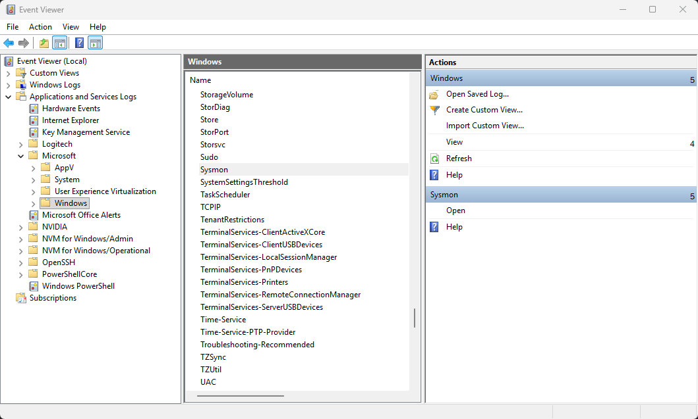

Sysmon 装完看不到网络或 DNS 记录，多数时候不是装错了：它由服务与配置两部分组成，服务负责采集，XML 配置决定采集范围，而默认配置只覆盖进程创建。

读完能判断机器上跑的是独立版还是 Win11 内置版、配置有没有真的生效。

## 安装前确认三件事

管理员权限、没有旧安装、架构对得上。独立版与 Win11 内置版互斥，先确认机器上有没有残留：

```powershell
# 1. 提权：非提权终端输出 False，账号在 Administrators 组里也一样
$id = [Security.Principal.WindowsIdentity]::GetCurrent()
([Security.Principal.WindowsPrincipal]$id).IsInRole('Administrator')
# 2. 旧安装
Get-Service *sysmon* -ErrorAction SilentlyContinue
# 3. 架构
$env:PROCESSOR_ARCHITECTURE   # AMD64 / ARM64 / x86
```

别用 `whoami /groups | findstr "S-1-5-32-544"` 判断提权：非提权的管理员账号也会匹配到 `Group used for deny only` 那一行，看着通过，真跑安装或换配置时照样报需要管理员。

有残留先卸载，两条路线命令不同：

```powershell
.\Sysmon64.exe -u    # 独立版
sysmon -u            # 内置版
```

## 独立版

从 Sysinternals 官网[下载](https://learn.microsoft.com/zh-cn/sysinternals/downloads/sysmon)压缩包并解压，三个可执行文件按架构区分：

| 文件            | 架构  | 用在哪     |
| :-------------- | :---- | :--------- |
| `Sysmon.exe`    | x86   | 32 位系统  |
| `Sysmon64.exe`  | x64   | 64 位系统  |
| `Sysmon64a.exe` | ARM64 | ARM64 设备 |

用**管理员**终端进入该目录：

```powershell
.\Sysmon64.exe -accepteula -i                        # 默认配置
.\Sysmon64.exe -accepteula -i .\sysmonconfig.xml     # 装完直接带配置
```

`-accepteula` 自动接受许可协议，不加会在安装时停下等你确认。装成功输出六行，服务和驱动各装一次、各启动一次：

```text
Sysmon64 installed.
SysmonDrv installed.
Starting SysmonDrv.
SysmonDrv started.
Starting Sysmon64..
Sysmon64 started.
```

驱动是 boot-start 的——开机时在文件系统就绪前加载，所以能记到服务还没起来时的进程活动。它的镜像路径写的是 `\SystemRoot\SysmonDrv.sys`，文件因此落在系统根目录，而不是 `System32\drivers`：

```powershell
sc.exe qc SysmonDrv
```

输出里 `START_TYPE` 为 `0 BOOT_START`，`BINARY_PATH_NAME` 给出驱动文件实际落地的位置。

## Win11 内置版

Win11 把 Sysmon 做成了可选功能，启用后程序随系统更新维护。管理员终端两行：

```powershell
Enable-WindowsOptionalFeature -Online -FeatureName Sysmon
sysmon -i
```

内置版的安装事件里命令行只有 `-i`，也不需要 `-accepteula`，许可随系统走；配置在装完之后单独加载即可。两条路线互斥——装内置版会接管独立版的服务和驱动：

| 项目       | 独立版                      | Win11 内置版               |
| :--------- | :-------------------------- | :------------------------- |
| 二进制     | 解压目录里的 `Sysmon64.exe` | 系统 `System32` 目录       |
| 服务名     | `Sysmon64`                  | `Sysmon`                   |
| 驱动位置   | 系统盘根目录                | `System32\drivers` 目录    |
| 写作时版本 | 15.22（随官网更新）         | 10.0.26100.x（随系统更新） |

按服务名和驱动文件核对落地情况：

```powershell
Get-Service *sysmon*                                  # Sysmon64 / Sysmon
Test-Path C:\Windows\SysmonDrv.sys                    # 独立版驱动
Test-Path C:\Windows\System32\drivers\sysmondrv.sys   # 内置版驱动
```

## 配置：SwiftOnSecurity

社区事实标准是 SwiftOnSecurity 维护的单文件配置，开箱即用[^1]。加载不用重装服务：

```powershell
Invoke-WebRequest -Uri https://raw.githubusercontent.com/SwiftOnSecurity/sysmon-config/master/sysmonconfig-export.xml -OutFile .\sysmonconfig.xml
sysmon -c .\sysmonconfig.xml             # 内置版
.\Sysmon64.exe -c .\sysmonconfig.xml     # 独立版
sysmon -s | Select-Object -First 1       # 内置版；独立版换 .\Sysmon64.exe -s
```

配置声明的语法版本和程序支持的不一致是正常的：这份配置写 `4.50`，`sysmon -s` 列出的 manifest 是 `4.91`，加载后照样输出 `Configuration file validated.` 和 `Configuration updated.`。

换配置换来的是覆盖面：同一台机器实测，默认配置下最早的 9 条事件只有 ID `1`、`4`、`5`、`16`（进程创建、进程终止、配置变更），换成这份配置后出现了 ID `3`、`11`、`22`（网络连接、文件创建、DNS 查询）。

## 验证配置生效

日志里有事件，不等于用的是你要的配置。

第一步看配置变更事件 `ID 16`，里面的 `Configuration` 是加载时写的路径，`ConfigurationFileHash` 是文件哈希。按 `Win+R` 输入 `eventvwr` 回车，在 **Event Viewer** 里打开：

```text
Event Viewer → Applications and Services Logs → Microsoft → Windows → Sysmon → Operational
右侧「筛选当前日志」→ 事件 ID 填 16
```



第二步把哈希和磁盘上的文件比对。事件里的值带 `SHA256=` 前缀、字母大写，`Get-FileHash` 的输出不带前缀，去掉前缀再比：

```powershell
Get-FileHash .\sysmonconfig.xml -Algorithm SHA256
```

两个值一致，说明正在生效的就是这份文件。

第三步看 `RuleName` 字段：社区配置给关键规则起了名字，命中时写出规则名（实测见过 `T1099`、`InvDB`、`Usermode`）；默认配置没有规则名，这个字段恒为 `-`。看到非 `-` 的值，说明规则真的在匹配，而不只是服务在跑。

日志里常见的几个 ID：

| ID   | 事件           | 什么时候出现                |
| :--- | :------------- | :-------------------------- |
| `1`  | ProcessCreate  | 有程序启动                  |
| `3`  | NetworkConnect | 进程发起或接受 TCP/UDP 连接 |
| `5`  | 进程终止       | 进程退出                    |
| `11` | 文件创建       | 文件被创建或覆盖            |
| `16` | 配置变更       | 加载或刷新配置              |
| `22` | DNS 查询       | 进程解析域名                |

读日志报 `Attempted to perform an unauthorized operation.` 是权限不够：把账号加进内置的 `Event Log Readers` 组（只读权限），重开终端即可。

```powershell
net localgroup "Event Log Readers" $env:USERNAME /add
```

## 日常维护

| 命令               | 作用                 |
| :----------------- | :------------------- |
| `sysmon -c`        | 打印当前生效的配置   |
| `sysmon -c <file>` | 换配置，不用重装服务 |
| `sysmon -c --`     | 恢复默认配置         |
| `sysmon -u`        | 卸载服务和驱动       |
| `sysmon -?`        | 看全部参数           |

表里统一写 `sysmon`：内置版它就是 `C:\Windows\System32\sysmon.exe`（已在 PATH 里），独立版换成解压目录里的 `.\Sysmon64.exe`。换配置同样要管理员，`-c` 也不例外——非提权执行返回 `You need to launch Sysmon as an Administrator.`，退出码 `740`，即 `ERROR_ELEVATION_REQUIRED`。

## 结语

装 Sysmon 是一次性动作，配置才是长期维护的部分。拿一份成熟配置当起点，再用配置哈希和 `RuleName` 确认它真的在起作用，比反复重装有用。

[^1]: [SwiftOnSecurity/sysmon-config exported config](https://raw.githubusercontent.com/SwiftOnSecurity/sysmon-config/master/sysmonconfig-export.xml)
